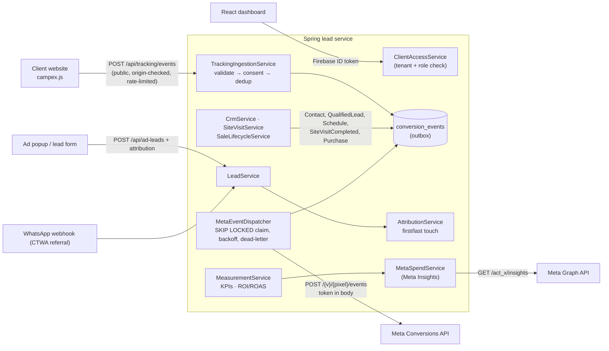
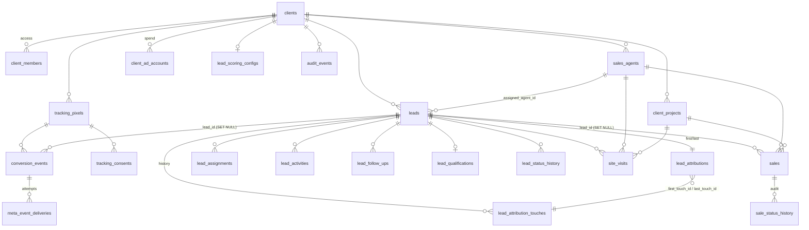

# Campex Phase 1 — Measurement Foundation

Implementation report for: Meta Pixel + Conversions API, conversion-event management, campaign-to-lead and
lead-to-sale attribution, the CRM pipeline, and site-visit tracking. Everything extends the existing
Spring lead service, its Flyway schema and the React dashboard. The FastAPI voice service is unchanged.

> **Not verified against Meta.** The Conversions API path was exercised end-to-end against a *local mock* of
> `POST /{version}/{pixel}/events` and with `MockRestServiceServer` in tests. No event has been sent to a real
> Meta pixel. Verify with an authorized Meta test pixel and a test event code before switching on
> `META_CAPI_ENABLED` in production (see §9).

---

## 1. Architecture changes



New code is grouped by module:

| Area | Package / files |
| --- | --- |
| Tenant access | `service/ClientAccessService`, `config/AccessProperties`, `controller/CrmController` (members) |
| Tracking + CAPI | `service/tracking/*` (catalog, hasher, ingestion, recorder, payload builder, CAPI client, dispatcher, retention, rate limiter), `config/TrackingProperties`, `resources/static/campex.js` |
| Attribution | `service/attribution/AttributionResolver`, `AttributionService` |
| CRM | `service/crm/*` (CrmService, CrmSetupService, LeadScoringService, SiteVisitService, SaleLifecycleService, FunnelSql) |
| Measurement | `service/measurement/MeasurementService`, `MetaSpendService`, `MetaGraphClient.insights` |
| Audit | `service/AuditService` + `audit_events`; `sale_status_history`; `lead_status_history` |

Design decisions:

- **Outbox, no new infrastructure.** `conversion_events` *is* the outbox. The dispatcher claims due rows with
  `FOR UPDATE SKIP LOCKED` and a lease (`locked_until`) — the same pattern the call scheduler already uses — so
  several instances never send the same event and a crashed worker's lease simply expires.
- **Three independent lead statuses.** `leads.status` (call lifecycle) and `leads.review_status` (accept/reject) are
  untouched. The new `leads.pipeline_status` is the operational sales stage.
- **Deterministic server event ids** (`lead-{id}-qualified`, `visit-{id}-completed`, `sale-{id}-purchase`) make CRM
  events idempotent. Browser events carry the SDK's `event_id`, also passed to `fbq` as `eventID` so Meta dedupes
  browser and server copies.
- **Nothing is invented.** Attribution keeps only ids actually received; WhatsApp referral `source_id` is treated as
  the **ad** id (never a campaign id); UTM names stay UTM; no evidence ⇒ `unknown`.

## 2. Database ER diagram



Tenant integrity: agent/project references use **composite foreign keys** `(client_id, agent_id) → sales_agents
(client_id, id)`, so the database itself rejects an agent or project from another client. Personal-data children of
`leads` cascade on lead deletion (existing opt-out behaviour); sales and conversion events keep their rows with
`lead_id` set to NULL so revenue and event history survive an opt-out.

## 3. Flyway migrations

| Version | Purpose |
| --- | --- |
| `V9__client_access_agents_projects.sql` | `client_members`, `sales_agents`, `client_projects`, `audit_events` |
| `V10__tracking_pixels_and_conversion_events.sql` | `tracking_pixels` (encrypted CAPI token), `tracking_consents`, `conversion_events` (unique `(client_id, dedup_key)`), `meta_event_deliveries` |
| `V11__lead_attribution.sql` | `leads.pipeline_status/email/assigned_agent_id/project_id/first_contacted_at/lost_reason`; `lead_attribution_touches`, `lead_attributions`; backfill one touch per existing lead |
| `V12__crm_pipeline.sql` | `lead_assignments`, `lead_activities`, `lead_follow_ups`, `lead_qualifications`, `lead_status_history`, `lead_scoring_configs` |
| `V13__site_visits_and_sales_lifecycle.sql` | `site_visits`; sales lifecycle columns, `sale_status_history`; backfill legacy sales |
| `V14__client_ad_accounts.sql` | Meta ad accounts per client (spend attribution) |

No earlier migration was edited. Backfills, on purpose:

- Existing CTWA/referral leads: `ad_id = coalesce(ad_id, campaign_id)` and **campaign unknown**, because the old code
  stored Meta's `source_id` (an ad id) in `leads.campaign_id`.
- Existing sales: `status = BOOKED`, `booking_value = amount`, `confirmed_revenue = 0`, `legacy_record = true`. They
  were typed in without payment detail, so they are not counted as confirmed revenue until someone confirms them.
  Existing charts keep using `amount` and are unchanged.

Validated by applying V1–V14 to PostgreSQL 16 with seeded legacy rows, and by booting the application with
`ddl-auto=validate` (all new entities match).

## 4. API endpoints

All `/api/**` routes except the two public tracking routes need a Firebase ID token. Every client-scoped call checks
the caller's membership **of the client that owns the resource** (looked up server-side). Unknown or foreign
resources return `404` (so other tenants' ids cannot be probed); insufficient role returns `403`.

Roles: `viewer` read · `agent` + operate CRM · `manager` + configure pixels/agents/projects, confirm/cancel sales ·
`owner` + manage members. Platform admins (`CAMPEX_PLATFORM_ADMIN_EMAILS`) reach every client.

**Public (website SDK)** — no login, CORS `*`, no credentials, origin must match the pixel's domains, rate limited.

| Method | Path | Notes |
| --- | --- | --- |
| POST | `/api/tracking/events` | Browser events. `202 {status: accepted|duplicate|ignored_no_consent, delivery_status}` |
| POST | `/api/tracking/consent` | Visitor consent decision |
| GET | `/campex.js` | The SDK (static) |

**Tracking & events**

| Method | Path |
| --- | --- |
| POST/GET | `/api/clients/{clientId}/tracking/pixels` |
| GET/PUT/DELETE | `/api/clients/{clientId}/tracking/pixels/{pixelId}` (DELETE is soft and wipes the token) |
| GET | `/api/clients/{clientId}/tracking/events?from&to&event_name&source&delivery_status&campaign_id&lead_id&limit&offset` |
| GET | `/api/clients/{clientId}/tracking/events/{eventId}` (includes delivery attempts) |
| GET | `/api/clients/{clientId}/tracking/events/summary?from&to` |
| POST | `/api/clients/{clientId}/tracking/events/test` `{pixel_id, event_name}` (uses the pixel's test event code) |
| GET/PUT | `/api/clients/{clientId}/measurement/ad-accounts` |

The spec's `POST /api/tracking/events` is the public ingestion route above.

**Attribution & measurement**

| Method | Path |
| --- | --- |
| GET | `/api/clients/{clientId}/attribution/summary?from&to` |
| GET | `/api/clients/{clientId}/attribution/campaigns?from&to&model=first_touch|last_touch&group_by=campaign|adset|ad&ad_account_id` |
| GET | `/api/clients/{clientId}/attribution/leads?from&to&campaign_id&source&unknown_only` |
| GET | `/api/leads/{leadId}/attribution` |
| GET | `/api/clients/{clientId}/measurement/kpis?from&to&campaign_id&agent_id&project_id&ad_account_id` |

**CRM**

| Method | Path |
| --- | --- |
| GET | `/api/clients/{clientId}/crm/pipeline?q&agent_id&project_id&source&campaign_id&per_column` |
| POST | `/api/clients/{clientId}/crm/leads` (manual lead; duplicate phone ⇒ 409) |
| GET/POST | `/api/clients/{clientId}/crm/agents`; PUT `/api/clients/{clientId}/crm/agents/{agentId}` |
| GET | `/api/clients/{clientId}/crm/performance?from&to` |
| GET/PUT | `/api/clients/{clientId}/crm/scoring` |
| GET/POST | `/api/clients/{clientId}/projects`; PUT `/api/clients/{clientId}/projects/{projectId}` |
| GET/POST | `/api/clients/{clientId}/members`; DELETE `/api/clients/{clientId}/members/{memberId}` |
| GET | `/api/leads/{leadId}/crm` (detail: qualification, follow-ups, history, duplicates, consent) |
| POST | `/api/leads/{leadId}/assign` |
| PATCH | `/api/leads/{leadId}/status` (LOST requires `lost_reason`) |
| POST/GET | `/api/leads/{leadId}/activities` |
| POST/GET | `/api/leads/{leadId}/follow-ups`; PATCH `/api/follow-ups/{id}` |
| PUT | `/api/leads/{leadId}/qualification` |
| POST | `/api/leads/{leadId}/tracking-consent` (staff-recorded ad-data consent) |

**Site visits**: POST `/api/leads/{leadId}/site-visits`, GET `/api/clients/{clientId}/site-visits`,
GET `/api/site-visits/{visitId}`, PATCH `/api/site-visits/{visitId}/status`, POST `/api/site-visits/{visitId}/reschedule`.

**Sales**: GET/POST `/api/clients/{clientId}/sales`, GET/PUT `/api/sales/{saleId}`, POST `/api/sales/{saleId}/confirm`,
POST `/api/sales/{saleId}/cancel`.

**Modified (backward compatible)**

- `POST /api/ad-leads` accepts optional `email` and `attribution` (the object `Campex.getAttribution()` returns).
- `LeadDto` gains `pipeline_status` and `assigned_agent_id`.
- `DELETE /api/sales/{id}` is now a soft delete; legacy lists and analytics exclude deleted sales.
- `POST /api/clients` makes the creator the client's owner.
- `CORS` adds `PUT`.

### Lifecycle rules

Pipeline: `NEW → CONTACTED | QUALIFIED | SITE_VISIT_SCHEDULED | LOST`, … `NEGOTIATION → WON | LOST`, `WON → LOST`,
`LOST → NEW | CONTACTED | QUALIFIED`. Manual moves must follow these edges. Automatic moves (logging a call,
completing a visit, recording or confirming a sale) only ever move forward and may skip stages; a confirmed sale
always marks the lead WON.

Sales: `NEW → BOOKING_PENDING → BOOKED → PAYMENT_PENDING → PARTIALLY_PAID → FULLY_PAID`, cancel from any open state,
`REFUNDED` after payment or cancellation. Amounts must match the status (FULLY_PAID needs the full value collected,
refunded ≤ collected ≤ booking value).

### Revenue and spend rules

| Figure | Definition | Provenance |
| --- | --- | --- |
| Booking value | Agreed price on bookings (booking date in range) | manual financial |
| Amount collected | Collected − refunded (booking date in range) | manual financial |
| Confirmed revenue | Collected − refunded on sales **confirmed** in range; 0 for cancelled/refunded | manual financial |
| Meta spend / impressions | Meta Insights for the client's mapped ad accounts, same dates | Meta-reported |
| Lead funnel | Leads **created** in range and the furthest stage each reached | CRM-verified |
| ROAS | Confirmed revenue ÷ Meta spend | derived |
| ROI | (Confirmed revenue − spend) ÷ spend | derived |

A sale inherits the lead's **first-touch** campaign/ad set/ad at creation (overridable). In the campaign report,
`model=last_touch` re-maps lead-linked sales to the lead's last touch. Spend cannot be split by sales agent or
project, so those filters blank cost metrics instead of estimating them. If an ad account's currency differs from
`APP_CURRENCY`, cost metrics are hidden. Imported reach (`ad_reach`) is never used as Meta data.

### Lead scoring (explainable)

Default weights (configurable per client via `/crm/scoring`): budget overlaps project price range 25 · preferred
location matches project 20 · timeline immediate 20 (within 3 months: half) · genuine interest confirmed 15 ·
valid phone or email 10 · financing self-funded/pre-approved 10 (home loan: half).
`score = round(100 × earned ÷ total weight)`; every factor is stored with its points and a plain-language reason.

## 5. React screens and components

| Navigation | Component(s) | Contents |
| --- | --- | --- |
| Measurement → KPIs | `AttributionPage.tsx#MeasurementPage` | All KPIs with a source badge, funnel, tracked events; filters for campaign, agent, project, ad account |
| Measurement → Attribution | `AttributionPage.tsx#AttributionPage` | Unknown %, first vs last touch, leads/revenue by campaign/ad set/ad, ROI table |
| Measurement → Tracking & events | `TrackingPage.tsx` (`EventMonitor`, `PixelManager`, `InstallGuide`, `AdAccountSettings`) | Delivery KPIs, event monitor with delivery attempts, pixel CRUD, test events, install snippet, ad-account mapping |
| Sales → CRM pipeline | `CrmPipelinePage.tsx`, `CrmLeadDrawer.tsx` | Kanban (8 stages), search/filters, new lead, team performance, agents and projects; drawer with stage moves, assignment, attribution, follow-ups, visit scheduling, qualification + score, timeline |
| Sales → Site visits | `SiteVisitsPage.tsx` (`VisitPanel`) | Week calendar, list, confirm/complete with outcome/no-show/reschedule/cancel |
| Sales → Sales | `SalesAttributionPage.tsx` (`RecordSaleForm`, `SalePanel`) | Revenue summary, sales list, record form, payment updates, confirm, cancel, audit history |

Shared: `measurementApi.ts`, `measurementTypes.ts`, `measurementFormat.ts`, `measurementUi.tsx` (source badge, client
guard). `api.ts` now exports its authenticated `request` helper. All new screens require a selected client and use
the existing range selector and styles; layouts collapse for tablet and phone widths.

## 6. Environment variable changes

Spring (all optional, safe defaults):

| Variable | Default | Meaning |
| --- | --- | --- |
| `CAMPEX_PLATFORM_ADMIN_EMAILS` | empty | Firebase emails that may access every client. **Set this to your own email on deploy**, or nobody can open Phase 1 screens for existing clients (see §12). |
| `META_CAPI_ENABLED` | `false` | Master switch for sending to Meta. Events are stored either way. |
| `META_CAPI_MAX_ATTEMPTS` / `META_CAPI_BASE_BACKOFF_SECONDS` / `META_CAPI_BATCH_SIZE` | 8 / 30 / 50 | Retry policy (backoff doubles per attempt, capped at 6 h) |
| `META_CAPI_BASE_URL` | `https://graph.facebook.com` | Only for testing against a mock |
| `TRACKING_RATE_LIMIT_PER_IP` / `TRACKING_RATE_LIMIT_PER_PIXEL` | 120 / 3000 per minute | Public endpoint limits |
| `TRACKING_RETENTION_DAYS` / `TRACKING_PII_RETENTION_DAYS` | 395 / 30 | Delete events and consents / clear IP and user agent |

Reused: `META_GRAPH_API_VERSION` (CAPI and Insights version), `META_TOKEN_ENCRYPTION_KEY` (encrypts CAPI tokens; required to
store one), `APP_CURRENCY`.

Dashboard (Vercel): `VITE_CAMPEX_TRACKING_URL` — optional public Spring origin used only to render the install snippet.

No new secret is exposed to React. `INTERNAL_SERVICE_KEY` and `AD_POPUP_TOKEN` are not used by any new browser code.

## 7. Meta Developer configuration

1. **Events Manager → Data sources → your Pixel** — copy the Pixel ID.
2. **Settings → Conversions API → Generate access token** (or a System User token with access to the pixel). Paste it
   into Tracking → Pixels → *Conversions API access token*. It is encrypted with `META_TOKEN_ENCRYPTION_KEY` and never
   returned.
3. **Test events** — copy the test event code into the pixel's *Test event code*.
4. Add your website domains to the pixel in Campex (and, if you use it, in Events Manager → *Traffic permissions*).
5. For spend: connect Meta Business under Channels (needs `ads_read`) and map the client's ad accounts under
   Tracking → Ad accounts.
6. Optional: if you also load the Meta Pixel (`fbq`) on the site, Campex reuses the same `eventID` for deduplication.

## 8. Pixel installation guide

```html
<script src="https://<campex-api-host>/campex.js"
        data-client-id="CLIENT_UUID" data-pixel-id="PIXEL_ID" async></script>
<script>
  // after the visitor's choice in your consent banner:
  Campex.consent({ analytics_storage: "granted", ad_storage: "granted", ad_user_data: "granted" });
  // conversions:
  Campex.track("Lead", { content_name: "Green Villas" }, { userData: { em: email, ph: phone } });
  // when submitting the lead form to POST /api/ad-leads:
  body.attribution = Campex.getAttribution();
</script>
```

Optional attributes: `data-consent-mode="not_required"` (only where you hold another lawful basis and the pixel is
configured the same way), `data-auto-pageview="false"`, `data-source="landing_page"`, `data-endpoint`,
`data-policy-version`.

Behaviour: with consent required (default) nothing is stored, no cookie is set and nothing is sent until consent;
events are queued in memory (max 20) and flushed on grant. `_cx_vid` (visitor) is set only with analytics consent;
`_fbc`/`_fbp` only with ad-storage consent. Email/phone are normalized and SHA-256 hashed in the browser. Supported
browser events: PageView, ViewContent, Lead, Contact, CompleteRegistration, Schedule. To capture campaign ids from
ads, add URL parameters in Ads Manager, e.g.
`utm_source=facebook&utm_campaign={{campaign.name}}&campaign_id={{campaign.id}}&adset_id={{adset.id}}&ad_id={{ad.id}}`.

## 9. Conversions API setup and verification

1. Deploy with `META_CAPI_ENABLED=false`; configure the pixel with token and test event code.
2. Tracking → Pixels → **Send test event**. With dispatch still off the event stays `pending`.
3. Set `META_CAPI_ENABLED=true` and redeploy. Within ~5 s the dispatcher sends it with `test_event_code`; confirm it
   appears in Events Manager → Test events and that Tracking → Events shows `sent` with an `fbtrace_id`.
4. Exercise a real flow on a test lead (status → Qualified, complete a visit, confirm a sale) and check the Test
   events tab. Remove the test event code from the pixel when done.

What is sent: `event_name`, `event_time`, `event_id`, `action_source` (website / chat / system_generated /
physical_store), `event_source_url` (website), `user_data` (hashed `em`, `ph`, `fn`, `external_id`; `fbc`, `fbp`;
`client_ip_address`/`client_user_agent` for website events; Meta `lead_id` when known), allow-listed `custom_data`.
CRM events are sent only with recorded ad-data consent (website consent linked through the visitor id, or consent
recorded by staff on the lead) unless the pixel is set to *not required*. Retryable failures (HTTP 429/5xx, Meta
transient codes) back off exponentially; after `META_CAPI_MAX_ATTEMPTS` the event is dead-lettered as `failed`.
Non-retryable errors fail at once; a bad event in a batch is isolated by resending the batch one by one.

## 10. Test execution results

| Suite | Command | Result |
| --- | --- | --- |
| Spring | `cd springboot-lead-service && mvn test` | **132 passed** (69 existing + 63 new); 4 DB-backed tests skipped without a database |
| Spring + PostgreSQL | `CAMPEX_IT_DATABASE_URL=jdbc:postgresql://127.0.0.1:55432/campex_it CAMPEX_IT_DATABASE_USER=campex mvn test` | **136 passed** |
| FastAPI | `cd fastapi-voice-service && .venv/bin/pytest` | 73 passed, 16 failed — **identical to the baseline before this change**; the failures come from a local `.env` (real `INTERNAL_SERVICE_KEY`) overriding test settings. No FastAPI file was changed. |
| Dashboard | `cd dashboard && npm test` | 4 proxy tests + **18 new UI tests** passed |
| Dashboard build | `npm run build` | passed |

New backend tests cover pixel CRUD and token handling, event validation, consent, deduplication, rate limiting,
hashing, CAPI payload generation, CAPI client error classification and token redaction, dispatcher retry, backoff and
dead-lettering, attribution priority, first-touch preservation and last-touch updates, scoring, pipeline and sale state
machines, assignment, site-visit lifecycle, sale lifecycle, role permissions, and cross-tenant isolation (unit level
and over HTTP against PostgreSQL). Meta is always mocked.

Additionally verified manually against a throwaway PostgreSQL 16 and a local mock Meta endpoint: full flow from pixel
setup → consented browser Lead (with dedup, origin, replay and Purchase-from-browser rejection) → manual lead with
website attribution → contact → qualify (score 95) → reschedule and complete a visit → booking → confirmation →
KPIs, campaign ROI, agent performance; CAPI delivery of all 7 events with the token only in the POST body; retry
then dead-letter on HTTP 500; immediate failure on HTTP 400.

## 11. Deployment

**Railway (Spring)**

1. Set `CAMPEX_PLATFORM_ADMIN_EMAILS` to the admin Firebase email(s) **before** deploying.
2. Keep `META_CAPI_ENABLED=false` for the first deploy. Confirm `META_TOKEN_ENCRYPTION_KEY` is set.
3. Deploy. Flyway applies V9–V14 on start (a few seconds; backfills touch every lead and sale once). Take a database
   backup first.
4. Note the public Railway origin — websites load `https://<origin>/campex.js` and post events there directly.
5. After verifying with a test event (§9), set `META_CAPI_ENABLED=true`.

**Vercel (dashboard)**: optionally set `VITE_CAMPEX_TRACKING_URL=https://<railway-origin>` and redeploy. The existing
proxy forwards the new `/api/*` routes unchanged; the public tracking routes are *not* meant to go through Vercel.

Run one Spring instance, or accept that rate limits are per instance (dispatching is already multi-instance safe).

## 12. Known limitations and pending tasks

- **Live Meta verification pending.** CAPI and Insights calls have only been tested against mocks.
- **Legacy endpoints are not tenant-scoped.** `/api/leads`, `/api/sales`, `/api/analytics`, `/api/clients` (list),
  `/api/dashboard` keep their pre-Phase-1 behaviour (any signed-in user sees all clients). Phase 1 routes are enforced.
  Next step: apply `ClientAccessService` to those routes once memberships exist for all users.
- **Membership bootstrap.** Existing clients have no members; until `CAMPEX_PLATFORM_ADMIN_EMAILS` is set or owners
  are added (`POST /api/clients/{id}/members`), non-admin users get 404 on Phase 1 screens. There is no members UI yet.
- **Meta instant-form (leadgen) webhook not built.** Instant-form leads can be entered with `meta_form_id` /
  `meta_lead_id` attribution via manual or backend lead creation; automatic leadgen ingestion (webhook + `leads_retrieval`)
  is pending.
- **Reminders are timeline entries only** (visits and follow-ups); no WhatsApp/SMS/email notification is sent.
- **Rate limiting is in memory, per instance.**
- **Legacy sales are not confirmed revenue** until confirmed in the new Sales screen (by design).
- **The new screens were checked by component tests and the API smoke run, not visually in a signed-in browser.**
- Agent performance and the CRM board are limited to 200 cards per column per request; use filters for large pipelines.
- Spend can't be broken down by agent or project; WhatsApp `business_messaging` action source is not used (chat is).
