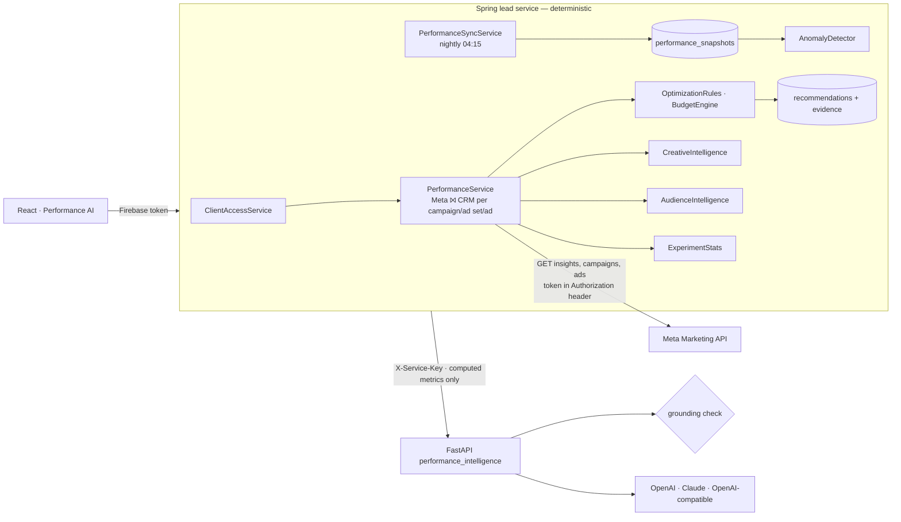
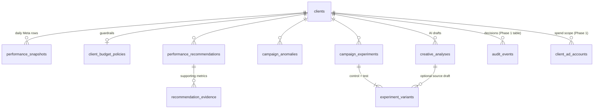

# Campex Phase 2 — Performance Intelligence & AI Campaign Optimization

Builds on Phase 1 (branch `phase1-measurement-foundation`), which this branch extends. Nothing in Phase 2 writes to
Meta: every Meta call is a GET, budgets are never changed automatically, and accepting a recommendation only records
the decision.

> **Not verified on a live ad account.** The full data path ran end to end against a fake Meta Graph API served by
> the integration test and against PostgreSQL. No real Meta Insights data or real AI provider was used. Verify with an
> authorized Meta account before relying on recommendations.

## 0. Gap analysis (Phase 1 dependencies)

| Needed by Phase 2 | Status before Phase 2 | Action |
| --- | --- | --- |
| Client ↔ ad-account mapping, Meta token per user | Present (Phase 1 `client_ad_accounts`, `MetaConnectionStore`) | Reused |
| CRM outcomes per campaign/ad (qualified, visits, bookings, revenue) | Present (Phase 1 attribution, CRM, sales) | Reused via `CrmOutcomeRepository` (same rules as Phase 1 KPIs) |
| Conversion events / delivery status | Present (`conversion_events`) | Reused for tracking-failure anomalies |
| Audit trail, tenant access | Present (`audit_events`, `ClientAccessService`) | Reused — no new audit table |
| Meta spend | Present but campaign-level spend/impressions only | Added reach, frequency, link clicks, Meta leads, budgets, creative metadata, breakdowns, daily series |
| Daily history for anomalies/fatigue | Missing | Added `performance_snapshots` + nightly sync |
| AI providers | OpenAI / OpenAI-compatible only | Added provider abstraction + Claude adapter (official `anthropic` SDK) |
| Number grounding for AI output | Missing | Added deterministic grounding check |

## 1. Architecture

Separation of duties:

| Concern | Where | How |
| --- | --- | --- |
| Metric calculation, comparisons, thresholds, statistics | Spring (Java) | Deterministic, unit-tested |
| Meta data retrieval for analysis | Spring `MetaPerformanceClient` (read-only) | The FastAPI MCP tools remain the assistant's drill-down path for chat; analysis uses the server-side client so numbers are computed under tenant checks |
| Explanations, Q&A phrasing, creative copy | FastAPI `PerformanceIntelligenceService` | Receives computed numbers only; never Meta tokens or personal data |
| Guarding AI output | FastAPI `check_grounding` | Every number in the answer must match the context; one corrective retry, then flagged |

## 2. Database ER diagram (V15)

Suggested entities mapped to tables: CampaignPerformanceSnapshot → `performance_snapshots`; PerformanceRecommendation /
BudgetRecommendation → `performance_recommendations` (`category` = optimization, budget, creative, audience, anomaly,
experiment); RecommendationEvidence → `recommendation_evidence`; CampaignAnomaly / PerformanceAlert →
`campaign_anomalies`; CreativeAnalysis → `creative_analyses`; CampaignExperiment / ExperimentVariant /
ExperimentResult → `campaign_experiments` (result JSON + outcome columns) and `experiment_variants`; OptimizationAudit /
BudgetChangeAudit → Phase 1 `audit_events`. CreativePerformance, AudiencePerformance and PlacementPerformance are
computed on request (with a 10-minute cache) rather than copied from Meta.

## 3. Flyway migration

`V15__performance_intelligence.sql` — new tables only; no earlier migration was changed. Notable constraints:

- `uq_performance_snapshots (client_id, level, object_id, day)` — idempotent daily upserts.
- `uq_performance_recommendations_open` — partial unique index: one **pending** recommendation per finding (duplicate prevention at the database level).
- `uq_campaign_anomalies_open` — one open/acknowledged alert per campaign+metric.
- `experiment_variants` requires an ad or ad set id and exactly one control and one test.

## 4. REST API

All routes require Firebase auth and client membership (viewer = read; agent = operate; manager = budget policy and
budget acceptance). Unknown or foreign resources return 404.

| Method | Path | Notes |
| --- | --- | --- |
| GET | `/api/clients/{id}/performance/overview?from&to&campaign_id` | Totals, previous equal period, % change |
| GET | `/api/clients/{id}/performance/campaigns` · `/adsets` · `/ads` | Meta ⨝ CRM rows, totals, data notes, metric sources |
| GET | `/api/clients/{id}/performance/compare` | Same as overview (current vs previous period) |
| GET | `/api/clients/{id}/performance/trends` | Daily series from snapshots, provisional days marked |
| POST | `/api/clients/{id}/performance/refresh` | Sync 28 days of daily snapshots, re-run anomaly detection |
| POST | `/api/clients/{id}/performance/ask` | `{question, from?, to?, comparison: previous_period\|previous_month}` |
| GET / POST | `/api/clients/{id}/recommendations` · `/recommendations/generate` | `generate` body `{from?, to?, explain?}` |
| GET / PATCH | `/api/recommendations/{id}` · `/status` | `{status: accepted\|rejected\|reviewed, note?}` |
| GET | `/api/clients/{id}/budget/analysis` · `/budget/recommendations` | |
| GET / PUT | `/api/clients/{id}/budget/policy` | Spending limits, max change %, thresholds |
| GET / POST | `/api/clients/{id}/creative-performance` · `/creative-analysis` | `creative-analysis` body `{ad_id, from?, to?}` → draft |
| GET | `/api/clients/{id}/audience-performance?breakdown=` · `/placement-performance` | Breakdowns: age, gender, age+gender, country, region, device_platform |
| GET / POST | `/api/clients/{id}/anomalies` · `/anomalies/detect` | |
| PATCH / POST | `/api/anomalies/{id}/status` · `/explain` | `{status: acknowledged\|resolved\|dismissed}` |
| GET / POST | `/api/clients/{id}/experiments` | |
| GET / POST | `/api/experiments/{id}` · `/start` · `/complete` | |

Default window: the last 28 **complete** days (ending yesterday). FastAPI (service key only): `POST /api/performance/ask`,
`/explain`, `/creative-suggestions`.

## 5. Performance calculation methodology

**Sources** (every response carries `metric_sources`): Meta-reported (spend, impressions, reach, frequency, link
clicks, Meta leads) · Campex-tracked (CRM leads) · CRM-verified (qualified leads, completed site visits, bookings) ·
manually entered (booking value, confirmed revenue) · derived (ratios) · estimated (projections, utilization).

- **Attribution windows:** every Meta request fixes `action_attribution_windows = 7d_click, 1d_view` (configurable), so all campaigns are compared on the same window. Meta leads = the aggregate `lead` action (falls back to instant-form + pixel lead parts; never both).
- **CRM:** leads by first-touch campaign/ad set/ad for leads created in the window; bookings by booking date; confirmed revenue by confirmation date (same rules as Phase 1 KPIs).
- **Ratios from totals:** CTR = link clicks ÷ impressions; CPC = spend ÷ link clicks; CPM = spend × 1000 ÷ impressions; cost per X = spend ÷ X; ROAS = **total confirmed revenue ÷ total spend** (never a sum or average of campaign ROAS). A zero denominator yields "—", not 0.
- **Totals** include only CRM outcomes matched to a Meta object in the mapped accounts; unmatched CRM outcomes are shown separately ("No matching Meta object") and excluded from ROAS.
- **Reach** is not additive: totals use Meta's period-level reach for a single account (or a single filtered campaign); across several accounts it is left blank.
- **Data quality notes:** Meta unavailable, provisional recent days (Meta revises), currency mismatch (account excluded), ad-account time zone differs from CRM time zone, unattributed CRM outcomes, reach not additive, small samples (`low_sample` flag < 1,000 impressions), Meta vs CRM lead gaps.

**Optimization rules** (peers = campaigns with the same Meta objective, same window): low qualified rate (< ½ peer
rate, ≥10 CRM leads); landing-page bottleneck (≥100 link clicks, click-to-lead < ½ peer rate); Meta vs CRM capture
gap (Meta leads ≥10, CRM < ½); ad CTR < 60% of the median of ≥3 ads with ≥1,000 impressions; high CTR (≥130% of
median) with qualified rate < ½ of the account. Confidence: ≥30 conversions high, ≥ minimum medium, else low.

**Budget:** benchmark = client target cost per qualified lead, else same-objective peers with ≥ min qualified leads.
Increase when cost per qualified lead ≤ 80% of benchmark, target ROAS met (if set) and utilization ≥ 80%; reduce at
≥150%; pause-for-review when spend ≥ 3× benchmark with zero qualified leads; otherwise maintain / insufficient data.
Changes are bounded by `max_change_pct` (default 20%) and capped by the client's daily/monthly limit headroom;
reallocation is proposed only between an increase and a reduce candidate with the same objective. Expected impact is
always labelled an estimate (e.g. extra qualified leads if the current cost held — stated as an upper bound).

**Anomalies:** current window = last 3 complete days (Meta delay 1 day), baseline = previous 14 days. Thresholds
(warning / critical): spend +50%/+100%, CTR −25%/−50%, CPC & CPM +30%/+60%, Meta leads −40%/−70%, conversion rate
−30%/−60%, cost per qualified lead +40%/+80%, frequency +25%/+60% (and ≥3). With ≥7 baseline days, a z-score of the
current daily mean vs baseline days must be ≥2 (≥3 for critical); otherwise the change is INFO. Minimum samples per
metric; plus "no qualified leads despite ≥2× baseline cost", Conversions API failures (≥5 and ≥20% in 24h) and missing
Meta data. Dedup: one open alert per campaign+metric (re-detection updates it); 24h cooldown after resolve/dismiss.

**Creative fatigue:** last 7 vs previous 7 days per ad: link CTR fell ≥20% while average frequency ≥2.5 (or rose ≥20%),
≥1,000 impressions in each window. Ranking uses cost per qualified lead when ≥2 ads have 3+ qualified leads, else Meta
cost per lead (≥2 ads with 5+ leads), else CTR.

**Experiments:** rates (CTR, conversion rate) — two-sided two-proportion z-test; costs (CPC, cost per lead / qualified
lead / site visit / booking) — conversions per unit of spend compared with a conditional binomial test (normal
approximation). A winner requires both arms ≥ minimum sample, ≥20 total events, and p < 1 − confidence (0.90/0.95/0.99);
otherwise "no reliable winner", or "inconclusive" when completed without enough data. One primary metric per experiment.

## 6. AI provider integration

`services/llm_providers.py` selects an adapter by task configuration:

| Provider | Adapter | Notes |
| --- | --- | --- |
| `openai` / `openai_compatible` | `OpenAIChatAdapter` (existing chat-completions endpoint) | JSON mode for structured tasks |
| `anthropic` | `AnthropicAdapter` — official `anthropic` Python SDK, `client.beta.messages.create` | Default model `claude-opus-5-5`, `output_config.effort` (default `medium`), structured JSON via `output_config.format`, server-side refusal fallback (`server-side-fallback-2026-07-01`, `fallbacks: "default"`) — disable with `ANTHROPIC_REFUSAL_FALLBACK=false` on platforms without it; `refusal` / `max_tokens` stop reasons handled |

Tasks: performance Q&A, recommendation/anomaly explanations (stored only when grounded), creative variants (saved as
drafts; any number not present in the input is listed as `unverified_numbers`). Image generation stays on the
existing OpenAI Images integration via Campaign Studio. Provider keys stay in FastAPI; React never sees them; Meta
tokens are never sent to FastAPI for these tasks.

## 7. React screens

Sidebar **Performance AI** → `PerformanceIntelligencePage.tsx` with tabs: Overview (KPIs with source badges and %
change, daily trend chart, campaign table, Ask-the-analyst panel), Recommendations (`RecommendationsPanel.tsx` — cards
with confidence/risk/estimate, evidence table, accept/reject/review), Budget (`BudgetPanel.tsx` — budgets, utilization,
decisions, recommended allocation chart, guardrails form), Creative (`CreativePanel.tsx` — creative cards with
best/worst and fatigue, headline/CTA comparisons, draft generation), Audience (`AudiencePanel.tsx` — Meta breakdowns,
placements, CRM segments and insights), Anomalies (`AnomalyPanel.tsx`), Experiments (`ExperimentPanel.tsx`). Shared:
`intelligenceApi.ts`, `intelligenceTypes.ts`. Uses the existing range selector, client switcher, Recharts and styles;
responsive at phone width.

## 8. Environment changes

Spring: `META_GRAPH_BASE_URL`, `META_ATTRIBUTION_WINDOWS` (`7d_click,1d_view`), `PERFORMANCE_SYNC_ENABLED` (`true`),
`PERFORMANCE_SYNC_LOOKBACK_DAYS` (28), `PERFORMANCE_MIN_IMPRESSIONS` (1000), `PERFORMANCE_MIN_CLICKS` (50),
`PERFORMANCE_MIN_CONVERSIONS` (10), `ANOMALY_COOLDOWN_HOURS` (24). Reuses `VOICE_SERVICE_URL` and `INTERNAL_SERVICE_KEY`.

FastAPI: `PERFORMANCE_AI_PROVIDER` (`openai|openai_compatible|anthropic`, empty = reuse `AI_PROVIDER`),
`PERFORMANCE_AI_MODEL`, `ANTHROPIC_API_KEY`, `ANTHROPIC_MODEL` (`claude-opus-5-5`), `ANTHROPIC_EFFORT` (`medium`),
`ANTHROPIC_REFUSAL_FALLBACK` (`true`). New dependency: `anthropic>=2.11,<3` in `requirements.txt`.

Dashboard: none.

## 9. Test results

| Suite | Command | Result |
| --- | --- | --- |
| Spring | `cd springboot-lead-service && mvn test` | 167 run, 0 failures; 6 DB-backed tests skipped without a database |
| Spring + PostgreSQL | `CAMPEX_IT_DATABASE_URL=jdbc:postgresql://…/disposable_db mvn test` | **167 passed** (incl. tenant isolation and the Phase 2 end-to-end test against a fake Meta Graph API) |
| FastAPI | `cd fastapi-voice-service && .venv/bin/pytest` | 86 passed, 16 failed — the 16 are the pre-existing failures from the baseline (local `.env` overrides test settings); 13 new AI tests pass |
| Dashboard | `cd dashboard && npm test && npm run build` | 4 proxy + 26 UI tests passed (8 new); build passed |

Phase 2 tests cover: metric aggregation and ROAS from totals, Meta ⨝ CRM assembly, missing Meta data, budget logic
(including the specification's Campaign A/B example, objective separation, small samples, spending-limit caps, target
ROAS), optimization rules, anomaly detection (thresholds, z-score, sample guards, missing data), experiment statistics
(z-test values, inconclusive/no-winner, spend-normalized cost metrics), creative fatigue/ranking/grouping, audience
flags, Meta client request shape (fixed attribution windows, token in header, lead de-duplication, budget units,
breakdown whitelist), tenant isolation of every Phase 2 route, and the full data flow end to end (all Meta calls GET,
token never in a URL). AI tests cover grounding (fabricated numbers, multipliers, lakh/crore), retry, missing data,
explanation/creative validation, and both provider adapters (no real provider calls).

## 10. Deployment

1. Deploy Phase 1 first (this branch includes it). Railway Spring: Flyway applies V15 on start; set any Phase 2
   variables you want to change (defaults are safe).
2. Railway FastAPI: install the new requirement (the Dockerfile's `pip install -r requirements.txt` does it); set the
   provider variables. With none set, Phase 2 works without AI text and "Ask" returns 503.
3. Map each client's Meta ad accounts (Tracking → Ad accounts) and make sure the mapping user has a Meta Business
   connection with `ads_read`; the nightly sync (04:15 server time) then fills snapshots. Use "Refresh Meta data" once
   after deploying.
4. Vercel: redeploy the dashboard; no new variables.

## 11. Known limitations and remaining work

- Not validated against a live Meta ad account or a real AI provider (only fakes/mocks).
- Lead quality, visits and bookings per Meta audience segment or placement are **not measurable**: Campex leads do not
  carry Meta's segment. Screens show Meta-reported leads per segment and CRM segments from qualification answers
  separately.
- The analysis uses Spring's read-only Meta client rather than the FastAPI MCP tools so that numbers are computed under
  tenant checks; the MCP tools remain the chat assistant's drill-down path. "Ask" answers from the computed context
  only (no live MCP calls).
- Budget utilization assumes the current daily budget applied for the whole window (labelled an estimate); lifetime
  budgets get no daily proposal.
- Rate limits and caches are per instance; the nightly sync uses the Meta connection of the user who mapped the ad
  account.
- Statistical tests assume independent events and a single primary metric; no sequential-testing correction for
  repeatedly peeking at interim results (shown as "interim").
- No automatic budget or ad changes by design; applying a recommendation is manual in Ads Manager or Campaign Studio.
- Legacy (pre-Phase 1) endpoints remain workspace-wide, as noted in the Phase 1 report.
