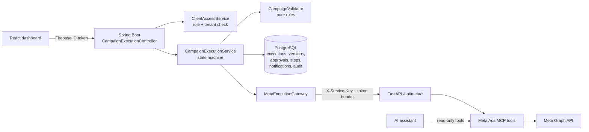
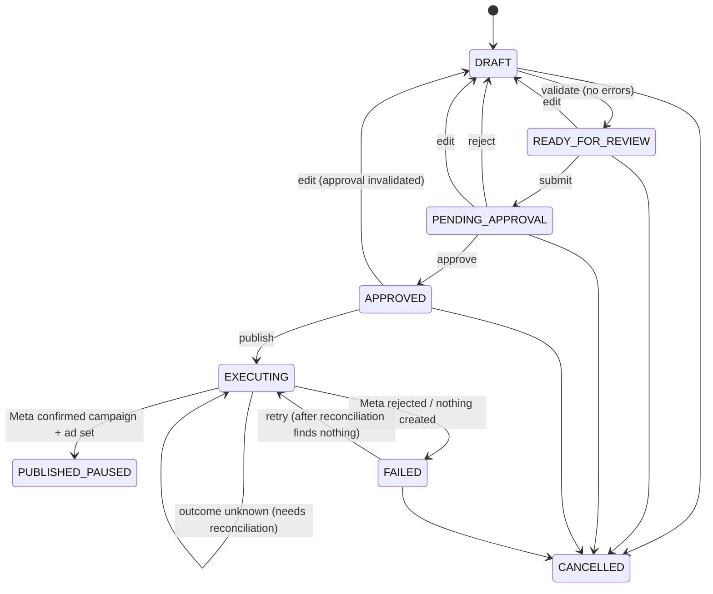
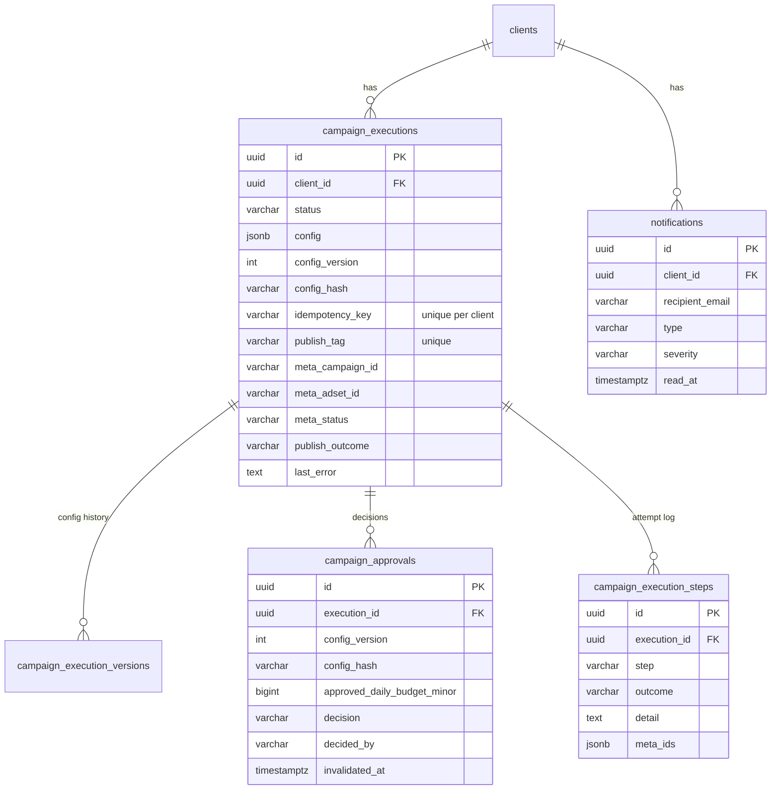
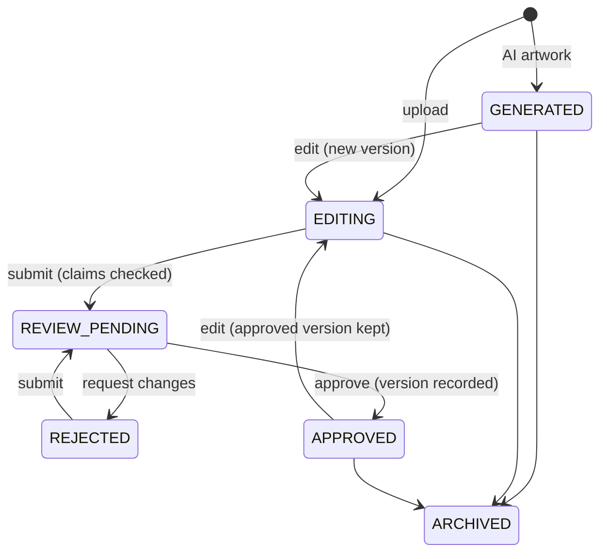
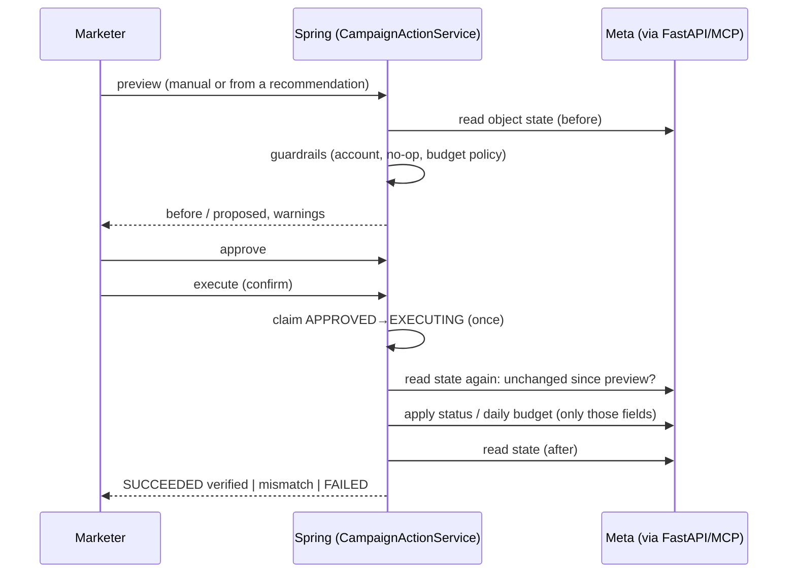
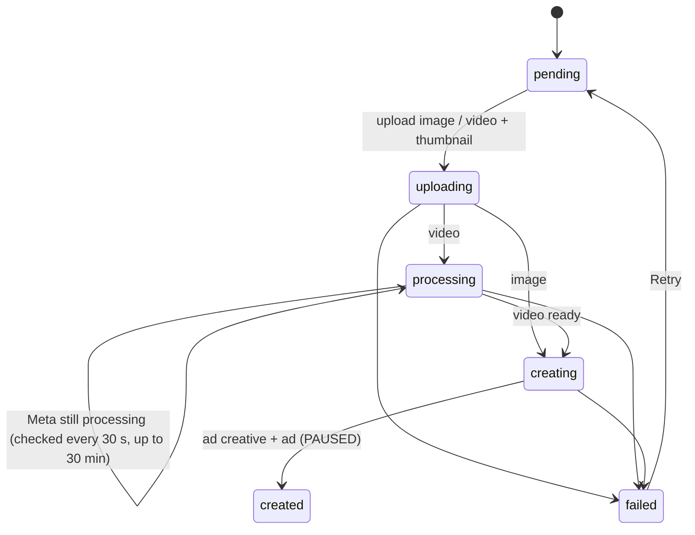

# Phase 3 — Campaign execution & automation

Core rule: **AI recommends and prepares. A person approves. Spring Boot validates and executes. Campex records the
result.** Nothing in Phase 3 lets an AI model, a rule or a stale browser tab change a live Meta campaign without an
approval recorded against the exact configuration being executed.

Phase 3 is delivered in increments. This document is updated with each one; sections marked *planned* are not built.

| # | Increment | Status |
|---|-----------|--------|
| 1 | Campaign execution engine: drafts, validation, approval, idempotent PAUSED publish, reconciliation, notifications | **built** |
| 2 | Campaign Studio → approval flow; Campaign approvals page (history, validation, approvals, actions); notification bell | **built** |
| 3 | Creative Studio: AI copy with claim checks, artwork generation/upload, persistent storage, versions, review, attach to campaigns | **built** |
| 4 | Optimization actions: pause / resume / daily budget, previewed from Meta, approved, applied once, verified | **built** |
| 5 | Automation rules: spend, CTR decline, cost per lead, delivery issues; levels 1–4 (level 4 off by default) | **built** |
| 6 | Experiment execution: readiness from Meta, approved launch, progress, follow-up only on a reliable winner | **built** |

---

## 1. Existing implementation assessment (gap analysis)

What exists before Phase 3, verified in the code:

| Area | What exists | Gap for Phase 3 |
|---|---|---|
| Campaign Studio (`dashboard/src/CampaignStudio.tsx`) | Single form: objective, platforms, location, ages, headline, body, CTA; AI copy/image suggestions; **drafts in browser `localStorage` only** | No server-side draft, no versions, no validation report, no approval |
| Publishing (`MetaCampaignPublishService`, `POST /api/meta/campaigns/publish`) | Owner-email scoped; `window.confirm` then a direct call to the FastAPI `create_paused_campaign` MCP tool; creates **campaign + ad set, both PAUSED**; no ad (no Meta image upload) | Not client-scoped, no approval record, **no idempotency** (double click = two campaigns), timeouts are not reconciled, result not stored |
| Meta MCP (`fastapi-voice-service/services/meta_ads_mcp.py`) | Read tools; write tools (`create_paused_campaign`, `set_campaign_status`, `update_ad_set`, `update_ad_status`, `create_ad_set`, `create_ad`, `create_ad_creative`, `delete_campaign`) guarded only by a `confirmed` flag; endpoint protected by the internal service key | Write tools have no notion of approval; must only be reachable from Spring's execution engine |
| AI assistant (`services/campaign_assistant.py`) | Allowlisted to `READ_ONLY_META_TOOLS` — the model cannot call write tools | Keep it that way (verified) |
| Creative generation | OpenAI Images via the assistant; images returned to the browser only | **No persistent storage**, no asset library, versions or approval |
| Phase 2 recommendations | Evidence-backed, `proposed_change` JSON, accept/reject recorded; never executed | Needs an execution path (increment 4) |
| Phase 2 experiments | Design, start/complete, statistics, "no reliable winner" outcome | Variants are not published from Campex (increment 6) |
| Anomalies / budget policies | Deterministic detection, `client_budget_policies` (daily/monthly limits) | Rules are fixed; no configurable rules engine (increment 5). Budget policy is reused by Phase 3 validation |
| Access control (`ClientAccessService`) | Per-client membership, roles `owner` / `manager` / `agent` / `viewer`, platform admins | Spec roles map onto these (see §7) |
| Audit (`audit_events`, `AuditService`) | Generic per-client audit trail | Reused for every Phase 3 transition |
| Notifications | None | New table + API (increment 1) |
| Tests | Unit tests + Postgres integration tests gated on `CAMPEX_IT_DATABASE_URL`; Meta always mocked | Same approach for Phase 3 |

## 2. Architecture

* The execution engine in Spring is the only caller of Meta write tools for Phase 3 flows.
* Meta tokens are resolved server-side (`MetaAccessResolver`) and sent to FastAPI in a header; they never reach the
  browser, an AI prompt, a log line or an error message.
* The engine never holds a database transaction open across a Meta call.

## 3. Campaign execution state machine

* `ACTIVE` exists in the status set but is only reached through an approved activation action (increment 4).
  Publishing always creates PAUSED objects.
* **Local status and Meta status are separate columns.** `status` is Campex's workflow state; `meta_status` /
  `meta_effective_status` are whatever Meta last reported, with `meta_checked_at`. A successful API call is not
  treated as "active".

### Duplicate prevention and reconciliation

1. **Create** accepts an `Idempotency-Key` header; the same key for the same client returns the existing execution.
2. **Publish** moves `APPROVED → EXECUTING` with a conditional `UPDATE … WHERE status = 'APPROVED'`. A second click,
   a second tab or a retrying proxy finds the row already `EXECUTING` and gets `409`.
3. Every execution has a unique **publish tag** (`cx-` + 10 hex chars). The Meta campaign is named
   `"<name> [cx-…]"`, so Campex can find the campaign it created without relying on the response.
4. If the Meta call fails or times out, the engine **reconciles before deciding**: it searches the ad account for the
   tag. Found → `PUBLISHED_PAUSED` (IDs recorded from Meta). Not found → `FAILED`, safe to retry. Lookup itself
   fails → stays `EXECUTING` with `publish_outcome = unknown`; `POST …/reconcile` repeats the lookup later.
5. **Retry never blindly re-creates.** It reconciles first and is refused if a Meta campaign ID is already known.
6. A partially created publish (campaign created, ad set rejected) is `FAILED` with the campaign ID recorded and
   cannot be retried; the paused campaign is finished or deleted in Ads Manager.

### Approval binding

An approval records the approver, timestamp, config version, **SHA-256 of the canonical config**, and the approved
daily budget. Publish re-validates and refuses unless the latest non-invalidated approval matches the current config
hash. Any edit creates a new config version, invalidates approvals and returns the execution to `DRAFT`.

## 4. Validation rules (`CampaignValidator`)

Errors block submit/approve/publish; warnings are shown but do not block.

| Check | Rule |
|---|---|
| Name | 1–140 chars (room for the publish tag) |
| Objective | `leads`, `traffic`, `sales`, `awareness` — the objectives the existing MCP tool maps to Meta `OUTCOME_*` |
| Platforms | non-empty subset of `facebook`, `instagram`, `whatsapp_ads` |
| Location | required, ≤ 160; resolved against Meta's location search at publish (ambiguous → Meta error, shown) |
| Age | 18–65, max ≥ min |
| Daily budget | ≥ 100 minor units; **error** if above the client's `daily_spend_limit` (Phase 2 budget policy) |
| Ad account | must be mapped to this client (`client_ad_accounts`) |
| Meta connection | a usable stored token for this client (checked at approve/publish) |
| Destination URL | required for `traffic`/`sales`; must be `https`, a public host (no localhost / IP literals) |
| Headline | required, ≤ 80; warning above 40 chars (truncation in feed) |
| Primary text | required, ≤ 1500; warning above 125 chars |
| CTA | one of `LEARN_MORE`, `SIGN_UP`, `CONTACT_US`, `MESSAGE_PAGE`, `BOOK_NOW`, `GET_QUOTE`, `APPLY_NOW` |
| Ad creation | **warning**: Campex creates the campaign and ad set (paused); the ad itself is not created until Meta image upload is implemented (§9) |

## 5. Data model (increment 1, migration `V16__campaign_execution.sql`)

Every transition also writes an `audit_events` row (actor, entity, action, before/after).

## 6. API (increment 1)

All routes require a Firebase-authenticated dashboard user and client membership. Responses never contain tokens.

| Method | Path | Permission | Notes |
|---|---|---|---|
| POST | `/api/clients/{clientId}/campaign-executions` | MANAGE | Body: config. Optional `Idempotency-Key` header |
| GET | `/api/clients/{clientId}/campaign-executions` | READ | Optional `status` filter |
| GET | `/api/campaign-executions/{id}` | READ | Includes versions, approvals, steps, last validation |
| PUT | `/api/campaign-executions/{id}` | MANAGE | Edit config → new version, back to `DRAFT` |
| POST | `/api/campaign-executions/{id}/validate` | MANAGE | Returns errors/warnings; `DRAFT → READY_FOR_REVIEW` when clean |
| POST | `/api/campaign-executions/{id}/submit` | MANAGE | `READY_FOR_REVIEW → PENDING_APPROVAL`; notifies approvers |
| POST | `/api/campaign-executions/{id}/approve` | MANAGE | Re-validates; binds approval to config hash |
| POST | `/api/campaign-executions/{id}/reject` | MANAGE | Body `{ "note": … }`; back to `DRAFT` |
| POST | `/api/campaign-executions/{id}/publish` | MANAGE | Body `{ "confirm": true }`; creates PAUSED campaign + ad set |
| POST | `/api/campaign-executions/{id}/reconcile` | MANAGE | Looks the publish tag up in Meta; refreshes `meta_status` |
| POST | `/api/campaign-executions/{id}/retry` | MANAGE | `FAILED` only; reconciles first |
| POST | `/api/campaign-executions/{id}/cancel` | MANAGE | Not allowed once executing/published |
| GET | `/api/notifications` | signed-in | Current user's notifications; `?unread=true` |
| POST | `/api/notifications/{id}/read` | recipient | |
| POST | `/api/notifications/read-all` | signed-in | |

Internal FastAPI additions (service-key protected, read-only): `POST /api/meta/campaigns/lookup` (find campaigns by
name fragment in one ad account) and `POST /api/meta/campaigns/status` (current status/effective status of one
campaign). The existing `POST /api/meta/publish` is reused for creation.

The legacy `POST /api/meta/campaigns/publish` stays for backward compatibility, but the dashboard no longer calls it:
Campaign Studio's button is now **Send for approval** (create or update the server draft, validate, submit), and
publishing happens from **Campaign approvals** after a recorded approval and an explicit acknowledgement.

## 6a. Creative Studio (increment 3)

* **Copy** (`POST /api/clients/{id}/creative/copy`): the brief plus the client's **verified facts** go to the configured
  LLM (same provider abstraction as Phase 2: OpenAI, Claude or OpenAI-compatible). Output: 5 headlines, 3 primary
  texts, 3 descriptions, CTA recommendations and 2–3 artwork concepts. English is the default; Telugu, Hindi and
  Kannada are offered as beta.
* **Claim check** (deterministic, `fastapi … /api/creative/check`): every number must appear in the verified facts;
  phrases such as guaranteed/assured returns, "double your money", "risk-free", "best investment", approval or
  possession claims not present in the facts are flagged. Generation retries once when its first draft fails the
  check; remaining problems are shown, never hidden.
* **Approval rules**: flagged phrases block approval; numbers not in the facts require the approver to tick "I verified
  the flagged figures", which is recorded on the approval.
* **Artwork** (`POST /api/clients/{id}/creative/generate`): OpenAI Images (`AI_IMAGE_MODEL`); with a reference image
  the GPT Image edits endpoint is used (DALL·E models refuse reference images with a clear message). The prompt
  forbids text, numbers, prices, logos and badges in the image, so factual claims live only in reviewable copy.
  Uploads are accepted as PNG, JPEG or WebP up to 8 MB, checked by magic bytes.
* **Storage**: image bytes are stored in PostgreSQL (`creative_images`, referenced by immutable `creative_versions`);
  provider URLs are downloaded immediately and never stored. Served only to client members via
  `GET /api/creative/images/{id}` with `Cache-Control: no-store`. Moving to object storage later only changes
  `creative_images`.
* **Campaign link**: a campaign draft can attach an approved creative (`creative_asset_id`, `creative_version`).
  Validation then requires that exact approved version and identical headline/primary text, so published copy is
  always the reviewed copy. Drafts without a creative get a warning.

| Method | Path | Permission |
|---|---|---|
| POST | `/api/clients/{clientId}/creative/copy` | MANAGE |
| POST | `/api/clients/{clientId}/creative/generate` | MANAGE |
| POST | `/api/clients/{clientId}/creative/assets` (upload) | MANAGE |
| GET | `/api/clients/{clientId}/creative/assets` | READ |
| GET | `/api/creative/assets/{id}` | READ |
| PUT | `/api/creative/assets/{id}` (new version) | MANAGE |
| POST | `/api/creative/assets/{id}/submit` · `/approve` · `/reject` · `/archive` | MANAGE |
| GET | `/api/creative/images/{imageId}` | READ |

## 6b. Optimization actions (increment 4)

* **Supported**: pause and resume a campaign, ad set or ad; set the daily budget of a campaign (CBO) or ad set. Nothing
  is created or deleted. Lifetime budgets, bids and targeting are not changed.
* **Guardrails** (`ActionGuardrails`): the object must belong to an ad account mapped to the client; no no-op changes;
  budget changes must stay within the client's `max_change_pct` (default 20%) and `daily_spend_limit`; resume warns
  that delivery and spend start immediately (and when a parent is paused).
* **Stale protection**: previews expire after 24 hours, and execution re-reads Meta first. If the fields being changed
  differ from the preview, nothing is sent and the change fails with "changed since the preview".
* **One open change per object** (unique index), and `APPROVED → EXECUTING` is a conditional claim, so concurrent
  clicks apply once.
* **Verification**: the result is what Meta reports afterwards, not the API response. Outcomes: `verified`,
  `mismatch` (accepted but not reflected; notification sent) or `unverified` (could not read back). On an error the
  state is read first; if Meta already shows the change it is recorded as applied, otherwise it fails and can be
  retried (status/budget writes set absolute values, so a retry cannot double-apply).
* **Recommendations**: increase/reduce-budget and pause-for-review recommendations pre-fill a preview
  (Phase 2 `proposed_change.to` × 100 → minor units, campaign level). Approving the change marks the recommendation
  accepted. Other recommendation types need the marketer to choose the action.
* Stored per action: `before_state`, `proposed_after`, `actual_after`, guardrail results, approver, executor and an
  event log, plus audit events.
* Fixed along the way: the MCP tools `update_campaign` and `update_ad_set` used to send `status=PAUSED` by default,
  so a rename or budget-only change would have paused the object. They now send only the fields given.

| Method | Path | Permission |
|---|---|---|
| POST | `/api/clients/{clientId}/campaign-actions/preview` | MANAGE |
| GET | `/api/clients/{clientId}/campaign-actions` | READ |
| GET | `/api/campaign-actions/{id}` | READ |
| POST | `/api/campaign-actions/{id}/approve` · `/reject` · `/cancel` | MANAGE |
| POST | `/api/campaign-actions/{id}/execute` (`{"confirm": true}`) | MANAGE |

FastAPI (service key only, not in the AI allowlist): `POST /api/meta/objects/state` (read) and
`POST /api/meta/objects/apply` (write, Spring only).

## 6c. Automation rules (increment 5)

Rules run on a schedule (`campex.automation.cron`, default every 15 minutes, each rule hourly or daily) or with
**Run now**. Evaluation is deterministic (`RuleEvaluator`) over the Phase 2 daily campaign snapshots; only the
delivery-issue rule reads Meta (read-only campaign statuses).

| Rule | Condition | Insufficient-data guard |
|---|---|---|
| Spend above limit (A) | Total spend on the latest day > threshold (₹). Latest day may be revised by Meta. | — |
| CTR decline (B) | CTR of the last N settled days vs the N before, decline ≥ threshold % (default 30) | Both windows need `min_sample` impressions (default 1,000) |
| Cost per lead too high (C) | Spend ÷ Meta-reported leads over N settled days > threshold (₹) | Needs `min_sample` leads (default 5) |
| Delivery problem (D) | Meta effective status `DISAPPROVED`, `WITH_ISSUES` or `PENDING_BILLING_INFO` | — |
| Insufficient data (E) | Built into every rule: thin windows are recorded as "not enough data" and never trigger anything | — |

Each rule has client scope and optional campaign scope, threshold, observation window, minimum sample, frequency,
severity, in-app notification preference, cooldown (no repeat alerts for the same campaign within N hours) and an
enabled flag.

| Level | What happens when it triggers |
|---|---|
| 1 MONITOR | Recorded in the run history |
| 2 RECOMMEND | Owners and managers are notified (spend → `budget_threshold_reached`, CPL → `cpl_increased`, delivery → `campaign_delivery_issue`, CTR → `optimization_recommendation_available`) |
| 3 APPROVAL_REQUIRED | A **pause** of the campaign is prepared in Optimization actions (source `automation`); a person approves and applies it |
| 4 PREAPPROVED | Pauses one campaign automatically through the same action engine (re-read, apply once, verify), recorded with `approved_by = automation:<rule>` |

Level 4 safeguards: **off unless `AUTOMATION_PREAPPROVED_ACTIONS_ENABLED=true`** (rules cannot even be saved at
level 4 otherwise); only `pause` (reversible, stops spend); only CTR/CPL rules scoped to a single campaign; daily cap
(`max_auto_actions_per_day`, 1–5) after which it falls back to preparing for approval; cooldown; every run audited
and notified. No level can raise a budget, resume or activate anything.

| Method | Path | Permission |
|---|---|---|
| GET | `/api/automation/settings` | signed-in |
| POST / GET | `/api/clients/{clientId}/automation-rules` | MANAGE / READ |
| PUT | `/api/automation-rules/{id}` | MANAGE |
| POST | `/api/automation-rules/{id}/enable` · `/disable` · `/run` | MANAGE |
| GET | `/api/clients/{clientId}/automation-executions` | READ |

FastAPI (service key, read-only): `POST /api/meta/campaigns/statuses`.

## 6d. Experiment execution (increment 6)

Builds on the Phase 2 experiments (design, interim and final statistics, `winner` / `no_reliable_winner` /
`inconclusive`). Phase 2 endpoints are unchanged; Phase 3 adds an execution layer (migration
`V20__experiment_execution.sql`: approved creative per variant, `experiment_executions` linking actions).

1. **Readiness** (`GET /api/experiments/{id}/execution`) reads each variant from Meta. Errors block launch: variant
   outside the client's ad accounts, deleted/archived, disapproved/with issues/pending billing, outside the
   experiment's campaign, mixed ad/ad set levels, creative tests on ad sets, control and test on the same object, an
   attached creative that is no longer the approved version. Warnings: different campaigns, no end date, shorter than
   7 days, minimum sample under 100.
2. **Launch** (`POST …/launch`, idempotent): if both variants are delivering, measurement starts (Phase 2 start).
   Otherwise each paused variant gets a **resume** Optimization action that someone approves and applies; calling
   launch again starts measurement once Meta shows both active. No duplicates are prepared.
3. **Progress**: days elapsed vs planned and whether the minimum sample is reached, with interim statistics and
   guidance ("keep it running…"). Completion stays a deliberate user action (Phase 2 `complete`), and the statistics
   only report a winner when the sample is sufficient and the difference is significant.
4. **Follow-up** (`POST …/follow-up`): only for `winner` results, prepares (does not apply) a **pause** of the losing
   variant for approval. With `no_reliable_winner` or `inconclusive` it is refused: nothing is replaced.
5. Variants can carry an approved creative (`PUT …/variants/{variantId}/creative`), so tested copy is reviewed copy.

| Method | Path | Permission |
|---|---|---|
| GET | `/api/experiments/{id}/execution` | READ |
| PUT | `/api/experiments/{id}/variants/{variantId}/creative` | MANAGE (draft only) |
| POST | `/api/experiments/{id}/launch` · `/follow-up` | MANAGE |

## 6e. Video ads and ad creation

Campaigns can now run a **video ad** (MP4/MOV, up to 60 s by default) as well as an image ad, and Campex creates
the ad itself after publishing, instead of leaving it to Ads Manager.

**Upload (Creative Studio → Artwork → Upload a video ad).** The browser reads the duration and captures a thumbnail
frame (Meta requires one for video ads), then uploads with a progress bar. Large files go **directly to the lead
service** (`CAMPEX_UPLOAD_URL`), because the Vercel proxy rejects request bodies over ~4.5 MB. The server streams the
file to disk, enforces the size limit while copying, reads the real duration from the MP4/MOV `moov/mvhd` header
(`Mp4Inspector`; it never decodes media) and rejects anything longer than `CAMPEX_MAX_VIDEO_SECONDS`. Videos are
stored under `CAMPEX_MEDIA_DIR` (a persistent volume), referenced by `creative_media`; thumbnails stay in
`creative_images`. Playback is fetched on demand by members of the client only, with HTTP range support.
Video creatives go through the same review as images: versions keep the video, and only the copy changes.

**Ad creation after publish** (`AdCreationService`, migration `V21__video_creatives_and_ads.sql`). When an approved
campaign is published (paused) with an approved creative, a destination URL and a Facebook Page, `ad_status`
becomes `pending` and a background worker (every 15 s, or **Check now**) runs:

* Every Meta ID (image hash, video ID, creative ID, ad ID) is stored as soon as Meta returns it; a retry continues
  from there and **never uploads or creates twice**. Before creating the ad, Campex looks for an ad in the ad set
  whose name carries the publish tag and links it instead of creating another.
* The ad is always created **PAUSED**. Nothing spends until someone activates it (an approved Optimization action).
* Without a creative, URL or Page, `ad_status` is `skipped` with the reason, and the ad is added in Ads Manager.
* FastAPI (service key only, not reachable from AI tools): `/api/meta/ads-builder/{image,video,video-status,creative,find-ads,ad}`.
  Video upload uses Meta's video host (`graph-video.facebook.com/{version}/act_{id}/advideos`); creatives use
  `object_story_spec.video_data` (video ID + thumbnail hash) or `link_data` (image hash).

| Method | Path | Permission |
|---|---|---|
| GET | `/api/creative/media-limits` | signed-in |
| POST | `/api/clients/{clientId}/creative/videos` (multipart: `video`, `thumbnail`, `name`, `ad_type`, `facts`) | MANAGE |
| GET | `/api/creative/videos/{mediaId}` | READ (range requests supported) |
| POST | `/api/campaign-executions/{id}/ad/check` · `/ad/retry` | MANAGE |

**New settings**

| Service | Variable | Default | Meaning |
|---|---|---|---|
| Spring | `CAMPEX_MEDIA_DIR` | empty (video disabled) | Directory for video files; on Railway, mount a volume there |
| Spring | `CAMPEX_MAX_VIDEO_SECONDS` | `60` | Longest video accepted |
| Spring | `CAMPEX_MAX_VIDEO_MB` | `200` | Largest video accepted |
| Spring | `CORS_ORIGINS` | — | Must include the dashboard's domain for direct uploads |
| Dashboard | `CAMPEX_UPLOAD_URL` | empty (same origin) | Public HTTPS URL of the lead service for uploads |

## 6f. Exact Meta locations and revising a rejected publish

Meta's location search often finds nothing for free text such as "Guntur, Andhra Pradesh", which made the publish
fail with "Meta could not match the target location".

- **Location picker.** Campaign Studio and the approvals edit form search Meta while you type
  (`GET /api/clients/{clientId}/meta/locations?q=`, MANAGE, read-only, using the client's Meta connection). Picking a
  suggestion stores `location_key` and `location_type` (city, region or country) in the config. The publish then
  targets that key directly, with no text matching.
- **Typed text still works.** A config without a key gets an `unverified` warning. At publish, FastAPI searches the
  full text; if nothing matches it searches the first comma part and keeps only results whose region or country
  matches the rest. Several matches fail with the options listed.
- **Hash compatibility.** Both fields are left out of the stored JSON when absent, so configs saved earlier keep their
  hash and their approvals.
- **Revise.** `POST /api/campaign-executions/{id}/revise` (MANAGE) moves a FAILED execution back to DRAFT, but only when
  Meta rejected the publish and nothing was created (`publish_outcome = 'rejected'`, no Meta campaign). Earlier
  approvals are invalidated, so the fixed campaign is validated, submitted and approved again. The approvals page
  shows this as "Edit and resubmit".

## 7. Roles and permissions

Spec roles map onto the existing per-client roles (no schema change needed yet):

| Spec role | Campex role | Create/edit/submit | Approve | Publish / retry / reconcile | Read |
|---|---|---|---|---|---|
| OWNER | `owner` | ✓ | ✓ | ✓ | ✓ |
| ADMIN / MARKETER | `manager` | ✓ | ✓ | ✓ | ✓ |
| ANALYST | `agent` | – | – | – | ✓ |
| CLIENT_VIEWER | `viewer` | – | – | – | ✓ |
| Platform admin | `CAMPEX_PLATFORM_ADMIN_EMAILS` | ✓ | ✓ | ✓ | ✓ |

Self-approval is allowed (single freelancers manage their own clients). A per-client "require a second approver"
setting is a planned option. Non-members get `404` (tenant ids cannot be probed); members without the permission get
`403`.

## 8. Configuration

Increment 5 adds (Spring, all optional):

| Variable | Default | Meaning |
|---|---|---|
| `AUTOMATION_ENABLED` | `true` | Scheduled rule evaluation |
| `AUTOMATION_CRON` | `0 */15 * * * *` | How often due rules are checked |
| `AUTOMATION_PREAPPROVED_ACTIONS_ENABLED` | `false` | Allows level 4 (pre-approved pause). Leave off unless the agency has agreed to it |

Earlier increments need no new environment variables. Uses the existing `CAMPEX_PLATFORM_ADMIN_EMAILS`, Meta OAuth settings,
`VOICE_SERVICE_BASE_URL` and internal service key.

## 9. Known limitations and unsupported Meta capabilities

* **Ad creation (image and video) has only been tested against mocks.** Verify it on a test ad account first: the
  Graph calls follow Meta's documented flow, but permissions (`ads_management`, Page access) and account settings
  vary. Ads are created as **link ads** to the destination URL; Meta instant lead forms are not supported yet.
* Lead campaigns optimize for `LEAD_GENERATION`; Meta may require a lead form for that goal. If ad creation fails for
  a lead campaign, use the Traffic objective with a landing page, or finish the ad in Ads Manager.
* Video uploads use Meta's single-request upload, suitable for short ads; very large files would need Meta's
  resumable upload, which is not implemented.
* Creative images live in PostgreSQL and videos on a mounted disk (`CAMPEX_MEDIA_DIR`). Back up that volume; moving
  to object storage (S3/R2) later only changes `MediaStorage`.
* Ad set schedule (start/end time), placements beyond the tool's defaults, special ad categories (housing!) and
  detailed targeting are not configurable yet. **Real-estate advertisers in many regions must declare the housing
  special ad category**; the current tool sends an empty list. Until that is configurable, review the campaign in Ads
  Manager before activating it.
* Activating a newly published campaign uses an Optimization action (resume) with approval; it is never automatic.
* Budget amounts assume a two-decimal currency (INR) when converting to Meta's minor units.
* Reconciliation relies on the campaign name containing the publish tag. Renaming the campaign in Ads Manager before
  reconciliation completes would hide it from the lookup.
* Notifications are in-app only; email/WhatsApp channels are planned.

## 10. Tests

* `CampaignValidatorTest` — validation rules, budget policy, URL safety.
* `CampaignExecutionServiceTest` — state machine, approval hash binding, duplicate publish prevention, timeout →
  reconciliation (found / not found / lookup failure), partial creation, retry refusal, role checks. Meta is mocked.
* `CampaignExecutionIntegrationTest` — HTTP + PostgreSQL (Flyway), tenant isolation, viewer cannot publish,
  idempotent create, concurrent publish yields exactly one Meta call. Gated on `CAMPEX_IT_DATABASE_URL`.
* FastAPI: lookup/status routes with a mocked MCP.

## 11. React screen inventory

| Screen | Where | Increment |
|---|---|---|
| Campaign Studio (sends drafts for approval) | Workspace → Campaign studio | 2 |
| Creative Studio + asset library | Workspace → Creative studio | 3 |
| Campaign approvals (approval center + execution history) | Workspace → Campaign approvals | 2 |
| Notification center | Bell in the top bar | 2 |
| Optimization actions | Measurement → Optimization actions | 4 |
| “Prepare change in Meta” on recommendations | Measurement → Performance AI → Recommendations | 4 |
| Automation rules + run history | Measurement → Automation rules | 5 |
| Experiment execution drawer | Measurement → Performance AI → Experiments → Launch… / Run in Meta | 6 |

All screens use the existing client switcher and role checks; viewers and agents see everything read-only.

## 12. Test results (end of increment 6)

| Suite | Result |
|---|---|
| Spring (`mvn test` with `CAMPEX_IT_DATABASE_URL` set) | 221 passed, 0 failed |
| Dashboard (`npm test`) | 4 node + 54 Vitest passed; `npm run build` OK |
| FastAPI (`pytest`) | 100 passed; 16 failures pre-date Phase 3 (campaign assistant `owner_email`, TTS preview and similar) and are unchanged |

Meta is mocked in every automated test; no test touches a real ad account.

## 13. Acceptance criteria

| Criterion | Where |
|---|---|
| Marketer can create a campaign draft | Campaign Studio / Campaign approvals (§3) |
| AI generates copy and image concepts | Creative Studio (§6a) |
| Marketer can preview the final creative | Creative drawer ad preview (§6a) |
| Configuration is validated | `CampaignValidator` (§4) |
| An authorized user approves publishing | Approvals bound to config hash (§3) |
| Campex creates a supported Meta campaign in PAUSED status | Publish (§3) |
| Protected against duplicate requests | Idempotency key, conditional claim, publish tag reconciliation (§3) |
| Failures are visible and recoverable | FAILED / unconfirmed states, Reconcile, Retry (§3) |
| Approved optimization actions execute safely | Optimization actions (§6b) |
| Automation rules monitor and alert | Automation rules (§6c) |
| No unapproved AI-driven live change | AI tools are read-only; every write goes through an approved action; level 4 is off by default and pause-only (§6b–6c) |
| Every action is audited | `audit_events`, step/event tables, approvals (§5, §6b) |
| Client data stays isolated | `ClientAccessService` on every route; tenant tests |
| Existing functionality keeps working | Full Spring/dashboard suites; legacy publish route kept |
